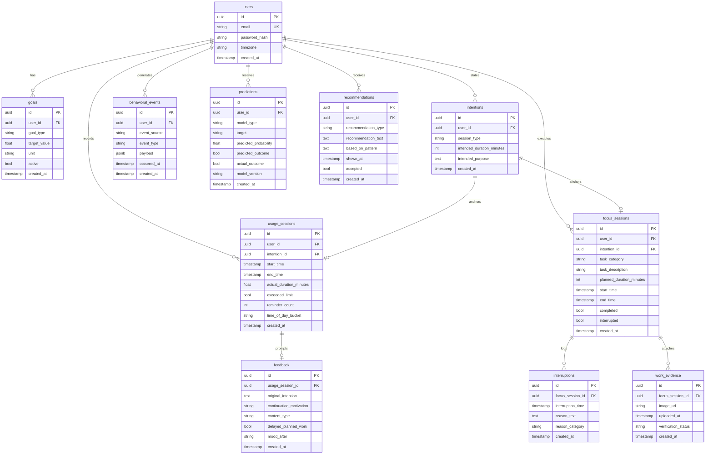

# AwareScroll AI + FocusLock — Technical Architecture & System Design Document

**Version:** 1.0.0  
**Status:** Approved for Implementation  
**Target Platform:** Android 10+ (API 29+), Jetpack Compose, Python 3.12+ FastAPI, PostgreSQL 16, Redis 7  

---

## 1. System Vision & Problem Statement

Modern screen-time tools impose blunt, binary interventions: they either display aggregate screen time hours after the fact or impose rigid app locks that trigger reactance and abandonment. They do not address *why* a session drifted from intention, and provide no actionable feedback loop.

**AwareScroll AI + FocusLock** addresses the root cause of digital drift across two connected modalities:
1. **AwareScroll AI**: Detects intention drift for Instagram by capturing stated session purpose and duration before launch, comparing it against real-time usage, and surfacing an empathetic reflection prompt at the boundary.
2. **FocusLock**: Protects blocks of deep work by enforcing soft-blocking restrictions against distracting app switches, logging interruptions and stated reasons.

Both mechanisms feed into a unified, relational **Behavioral Intelligence Engine** that powers descriptive analytics, pattern discovery, and predictive risk scoring.

```
                           +--------------------------------+
                           |  User States Pre-Session Goal  |
                           |  (Duration + Purpose / Task)   |
                           +---------------+----------------+
                                           |
                    +----------------------+----------------------+
                    |                                             |
                    v                                             v
       [ AwareScroll AI Loop ]                         [ FocusLock Loop ]
      Instagram Usage Monitoring                     Deep Work Block Guard
       (UsageStatsManager API)                     (AccessibilityService API)
                    |                                             |
                    v                                             v
        Limit Boundary Reached                         Interruption / Exit
                    |                                             |
                    v                                             v
       Empathic Reflection Modal                     Reason & Category Logging
        (Motivation / Content)                        (Boredom / Notification)
                    |                                             |
                    +----------------------+----------------------+
                                           |
                                           v
                        +------------------------------------+
                        | Unified Behavioral Dataset (Room)  |
                        | Syncs to PostgreSQL 16 via FastAPI |
                        +------------------+-----------------+
                                           |
                                           v
                        +------------------------------------+
                        |   Behavioral Intelligence Engine   |
                        | - Descriptive Analytics Summary    |
                        | - Behavioral Pattern Discovery     |
                        | - Predictive Overrun & Interruption|
                        +------------------+-----------------+
                                           |
                                           v
                        +------------------------------------+
                        | Informs User's Next Pre-Session    |
                        |  Stated Intention (Closed Loop)    |
                        +------------------------------------+
```

---

## 2. Technology Stack & Component Architecture

### 2.1 Mobile Client (Android Native)
- **Language**: Kotlin 1.9+
- **Min SDK**: API 29 (Android 10+) | **Target SDK**: API 34
- **UI Framework**: Jetpack Compose with Material3
- **Local Database**: Room (SQLite wrapper) with reactive Kotlin Flow
- **Background Work**: WorkManager for reliable, network-constrained offline sync
- **Networking**: Retrofit 2 + OkHttp 4 with automatic JWT Bearer token injection
- **System Services**:
  - `UsageMonitorService`: Foreground polling service using `UsageStatsManager` for Instagram foreground sessions
  - `FocusLockAccessibilityService`: Accessibility service for soft app redirection during active focus sessions

### 2.2 Backend API Service
- **Runtime**: Python 3.12+
- **Framework**: FastAPI (async, typed, auto-generated OpenAPI documentation)
- **ORM**: SQLAlchemy 2.0 (typed declarative mappings, cross-platform UUID and JSONB support)
- **Database Migrations**: Alembic
- **Authentication**: JWT access & refresh tokens (HMAC-SHA256)
- **Background Tasks**: Celery 5.4 + Redis 7 for nightly analytics aggregation and Celery Beat scheduled jobs

### 2.3 Database Layer
- **System of Record**: PostgreSQL 16 (relational schema, native JSONB for flexible payload events)
- **Local Cache**: Room SQLite on device for zero-latency offline operation

### 2.4 Behavioral Intelligence Engine
- **Core Libraries**: pandas, NumPy, scikit-learn
- **Model Pipeline**: Logistic Regression & Random Forest classifiers for overrun prediction; Decision Trees & Random Forest for interruption prediction
- **Serving**: Integrated directly in FastAPI `/predict` routes for sub-10ms inference latency

---

## 3. Database Schema (PostgreSQL 16)

Every table uses a UUID Primary Key (`id`) and UTC timestamp (`created_at`). Foreign keys strictly follow `<table>_id`.



---

## 4. API Specification

All protected endpoints require an HTTP `Authorization: Bearer <JWT>` header verified server-side.

| Endpoint | Method | Purpose | Key Parameters / Payload |
|---|---|---|---|
| `/api/v1/auth/register` | POST | Register new user account | `{email, password, timezone}` |
| `/api/v1/auth/login` | POST | Authenticate user | `{email, password}` |
| `/api/v1/auth/me` | GET | Retrieve authenticated profile | Bearer Token |
| `/api/v1/goals` | POST / GET | Setup and list daily limits | `{goal_type, target_value, unit}` |
| `/api/v1/intentions` | POST / GET | Log pre-session intention | `{session_type, intended_duration_minutes, intended_purpose}` |
| `/api/v1/usage-sessions` | POST / GET | Track Instagram session | `{intention_id, start_time, actual_duration_minutes, exceeded_limit}` |
| `/api/v1/focus-sessions` | POST / GET | Manage FocusLock blocks | `{task_category, task_description, planned_duration_minutes}` |
| `/api/v1/focus-sessions/{id}/interruptions` | POST | Log focus exit reason | `{interruption_time, reason_category, reason_text}` |
| `/api/v1/feedback` | POST | Post-limit reflection survey | `{usage_session_id, continuation_motivation, content_type, mood_after}` |
| `/api/v1/analytics/summary` | GET | Dashboard stat cards | `?uid=&range=30` |
| `/api/v1/analytics/patterns` | GET | Ranked behavioral insights | `?uid=` |
| `/api/v1/predict/overrun` | POST | Pre-session overrun risk score | `{intended_duration_minutes, intended_purpose, time_of_day}` |
| `/api/v1/predict/interruption` | POST | Pre-focus interruption risk | `{task_category, planned_duration_minutes, time_of_day}` |
| `/api/v1/recommendations` | GET | Personalized suggestions | `?uid=` |
| `/api/v1/export` | GET | CSV download of dataset | `?uid=&format=csv` |

---

## 5. Frontend Design System & Accessibility

- **Colors**:
  - Primary `#3A5BFF` / Primary Dark `#22348F`
  - Secondary & Success `#00B894`
  - Accent / Reflect `#FF9F43` (Warm amber, strictly reserved for reflection prompts)
  - Background Light `#F7F8FC` / Dark `#0E1021`
  - Surface Light `#FFFFFF` / Dark `#171A2E`
  - Error `#E5484D` | Border `#E2E4F0`
- **Typography**:
  - UI Text: Inter (H1 28sp Bold, H2 22sp SemiBold, H3 18sp SemiBold, Body 16sp Regular, Caption 12sp Medium)
  - Numeric Counters & Timers: IBM Plex Mono 32sp/36sp SemiBold tabular figures
- **Components**:
  - `PrimaryButton`: 12dp radius, 48dp height, 150ms press scale (0.97).
  - `ReflectButton`: Pill-shaped 24dp radius, Accent `#FF9F43` fill.
  - `StepperInput`: Structured integer stepper preventing free-text errors.
  - `FocusLockScreen`: Forced `#0E1021` background, full-screen lock sheet, deliberate exit confirmation.

---

## 6. Defensive Platform Permission Architecture

Android restricts `PACKAGE_USAGE_STATS` and `AccessibilityService` APIs:
1. **Explicit Justification Screen**: The app presents `PermissionExplanationScreen` explaining transparently why each permission is needed before dispatching system intents.
2. **Graceful Fallback**: If permissions are denied, the app transitions automatically to **Manual Check-in Mode**, allowing users to manually time and record their intentions and reflections without crashes or service failures.

---

## 7. Security & Sensitive Behavioral Data

1. **At-Rest Protection**: All user records, timestamps, and feedback payloads are stored in encrypted relational storage.
2. **Export Sanitization**: Free-text fields (`reason_text`, `intended_purpose`) are filtered out during CSV analytics export to prevent inadvertent disclosure of sensitive personal study or chat notes.
3. **Short-Lived Signed URLs**: Work evidence images utilize signed, time-limited S3/R2 URLs with restricted permissions.
